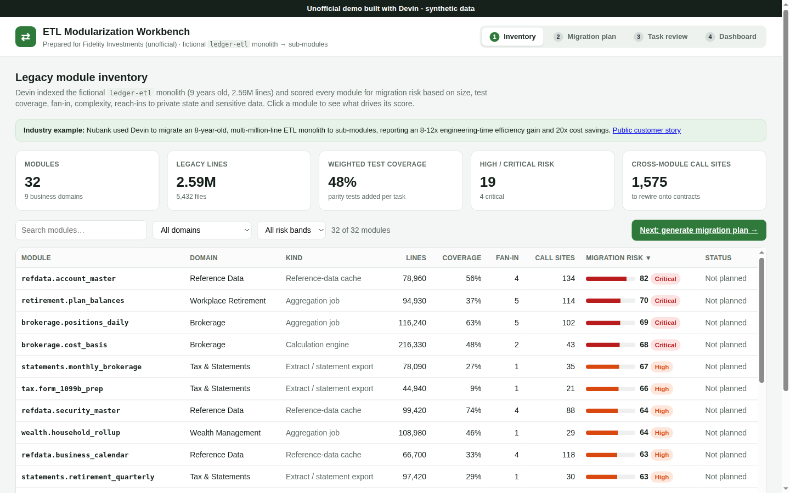

# ETL Modularization Workbench: unofficial demo for Fidelity Investments

> **Unofficial demo built with Devin - synthetic data.** Not affiliated with or endorsed by Fidelity Investments. Every module, team, table, record and number is fictional and generated by [`scripts/seed.py`](scripts/seed.py). No real customer data, credentials or private systems are used.

**Live demo:** https://htmlpreview.github.io/?https://github.com/AlexBiller/fidelity-etl-modularization-demo/blob/main/standalone.html
(renders `standalone.html`, a single self-contained build of this repo, straight from `main`; no server or login needed).
Alternative mirror of the multi-file version: https://raw.githack.com/AlexBiller/fidelity-etl-modularization-demo/main/index.html



A small web app showing how Devin could break up a large, long-lived ETL monolith into independently owned sub-modules: the kind of project described in Cognition's public Nubank customer story (an 8-year-old, multi-million-line ETL monolith migrated to sub-modules, with a reported 8-12x engineering-time efficiency gain and 20x cost savings). Here it is applied to a fictional financial-services monolith, `ledger-etl`: 32 Python modules, about 2.6M legacy lines across brokerage, workplace retirement, asset management, custody, market data, compliance, wealth, tax and statements.

## Walkthrough (under 5 minutes)

1. **Inventory**: browse the 32 seeded legacy modules with a 0-100 migration risk score. Search, filter by domain or risk band, and sort any column. Click a module to see what drives its score (size, test coverage, fan-in, complexity, reach-ins to private state, sensitive fields), its upstream and downstream modules, and a legacy code excerpt.
2. **Migration plan**: choose how many Devin sessions can run in parallel, the max modules per task, and whether critical-risk modules get their own task, then **Generate migration plan**. Modules are ordered into phases by dependency depth (foundation reference and market data first). Each phase is split into tasks with no dependencies between them, so they run in parallel: one Devin session and one PR per task.
3. **Task review**: open any task to compare the monolith code with the new sub-module side by side, see the generated tests (all passing once the task reaches review, including parity runs against golden snapshots), what Devin changed, the PR, and the session log. Use **Fast-forward to review** and **Approve & merge**.
4. **Dashboard**: press **Run simulation** (or **Advance 4h** / **Complete all**) to watch tasks move through Devin coding → Testing → In review → Merged. A task starts only when its upstream PRs have merged and a session is free. The dashboard shows modules and lines migrated, the burn-up chart, phase progress, the task board and an activity feed.

Plan and simulation state are kept in `localStorage`; **Reset demo** in the footer starts over.

## Run locally

No build step and no dependencies beyond Python 3:

```bash
python3 scripts/seed.py              # regenerates data/seed.json and data/seed.js (deterministic, seed 20261102)
python3 scripts/build_standalone.py  # rebuilds standalone.html (single-file version used by the live demo)
python3 -m http.server 8000          # open http://localhost:8000
python3 -m unittest discover tests   # seed invariants: deterministic, acyclic graph, label present
```

No login is required, so there are no demo credentials.

## How it works

| File | Purpose |
| --- | --- |
| `scripts/seed.py` | Seed script. Defines the 32 fictional modules, their dependency graph and six legacy code archetypes (reference-data cache, feed ingestion, reconciliation, aggregation, calculation engine, statement export). Each archetype has a legacy excerpt, the refactored sub-module code, a list of changes, generated tests and a parity test. It also computes the risk score and effort estimates. |
| `data/seed.json`, `data/seed.js` | Generated output (do not edit by hand). |
| `assets/app.js` | UI: inventory, plan generation (dependency-depth phases → parallel tasks), side-by-side line diff (LCS), and the progress simulation. |
| `assets/styles.css` | Styles. |
| `index.html` | Multi-file entry point. |
| `standalone.html` | Single-file build with CSS, data and JS inlined. |
| `tests/test_seed.py` | Checks on the seed data and the required label. |

### Risk score

Weighted sum of six normalised factors (size 20%, low coverage 22%, fan-in 18%, private reach-ins 16%, complexity 12%, sensitive fields 12%), scaled to 0-99. Bands: Critical ≥ 68, High ≥ 52, Medium ≥ 35, else Low.

### Effort numbers

`devin_hours`, `manual_hours` and `engineer_hours` per module are synthetic estimates from the seed script. Engineer hours with Devin are set in the 8-12x band reported in the public story; they are illustrative, not a forecast.

## Data and safety

- All data is synthetic and generated by a seeded script; nothing comes from real customers, systems or accounts.
- No credentials, APIs or third-party services are used. The app is static HTML/CSS/JS.
- The label "Unofficial demo built with Devin - synthetic data" is shown in a persistent banner on every screen.
